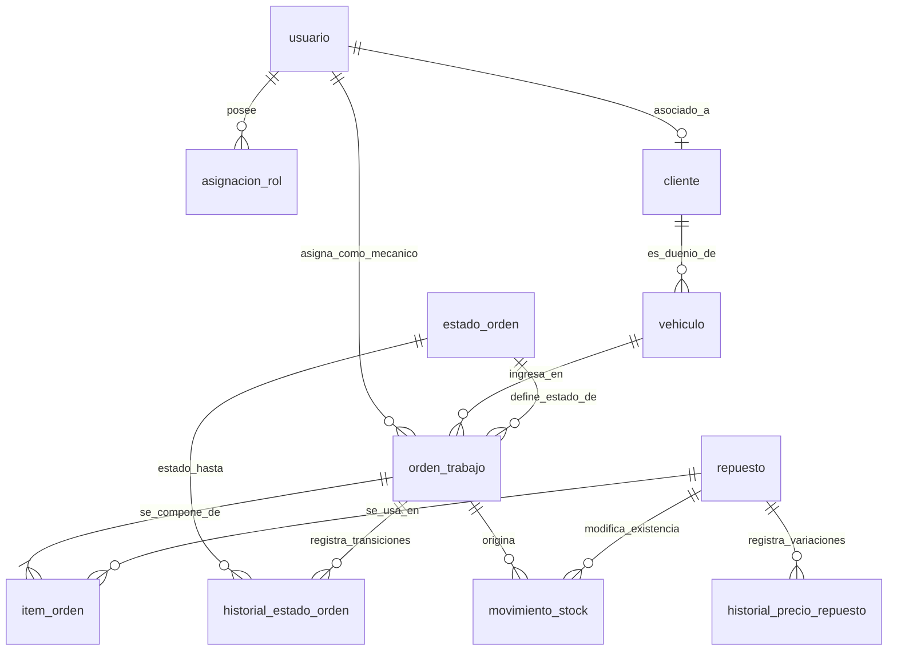

# Modelo de Datos

## Dominios y Módulos
1. **Usuarios y Seguridad:** `usuario`, `asignacion_rol`, `intento_acceso`, `evento_seguridad`.
2. **Clientes y Flota:** `cliente`, `vehiculo`.
3. **Repuestos y Stock:** `repuesto`, `movimiento_stock`, `historial_precio_repuesto`.
4. **Órdenes de Trabajo:** `estado_orden`, `orden_trabajo`, `item_orden`, `historial_estado_orden`.

## Diagrama Entidad-Relación (ERD)

## Entidades y Restricciones de Base de Datos

### 1. `usuario`
- `id`: BigInteger / Integer, PK, autoincremental
- `email`: String(255), not null, UNIQUE
- `nombre`: String(255), not null
- `password_hash`: String(255), not null
- `activo`: Boolean, not null, default True
- `debe_cambiar_password`: Boolean, not null, default False
- `password_cambiada_en`: Timestamptz, nullable

### 2. `asignacion_rol`
- `id`: BigInteger / Integer, PK
- `usuario_id`: Integer, FK a `usuario.id`, not null, indexed
- `rol`: String(50), not null, CHECK (`rol IN ('ADMIN', 'RECEPCION', 'MECANICO', 'CLIENTE')`)
- `desde`: Timestamptz, not null, default NOW()
- `vence_en`: Timestamptz, nullable
- `revocada_en`: Timestamptz, nullable
- `otorgada_por`: Integer, FK a `usuario.id`, nullable
- **Índice Único Parcial:** `UNIQUE (usuario_id, rol) WHERE revocada_en IS NULL`

### 3. `intento_acceso`
- `id`: BigInteger / Integer, PK
- `cuando`: Timestamptz, not null, default NOW()
- `email`: String(255), not null
- `ip`: String(50), not null
- `exito`: Boolean, not null
- **Índice compuesto:** `(email, ip, cuando)`

### 4. `evento_seguridad`
- `id`: BigInteger / Integer, PK
- `cuando`: Timestamptz, not null, default NOW()
- `actor`: String(255), not null (texto, puede ser "SISTEMA" o email/id)
- `accion`: String(255), not null

### 5. `cliente`
- `id`: BigInteger / Integer, PK
- `usuario_id`: Integer, FK a `usuario.id`, nullable, UNIQUE (uno a uno opcional)
- `nombre`: String(255), not null
- `documento`: String(50), not null, UNIQUE
- `telefono`: String(50), not null

### 6. `vehiculo`
- `id`: BigInteger / Integer, PK
- `cliente_id`: Integer, FK a `cliente.id`, not null, indexed
- `patente`: String(20), not null
- `marca`: String(100), not null
- `modelo`: String(100), not null
- `anio`: Integer, not null, CHECK (`anio BETWEEN 1950 AND 2100`)
- `borrado_en`: Timestamptz, nullable
- **Índice Único Parcial:** `UNIQUE (patente) WHERE borrado_en IS NULL`

### 7. `repuesto`
- `id`: BigInteger / Integer, PK
- `codigo`: String(50), not null
- `descripcion`: String(255), not null
- `precio`: Numeric(10, 2), not null, CHECK (`precio > 0`)
- `stock`: Integer, not null, default 0, CHECK (`stock >= 0`)
- `borrado_en`: Timestamptz, nullable
- **Índice Único Parcial:** `UNIQUE (codigo) WHERE borrado_en IS NULL`

### 8. `estado_orden` (Catálogo)
- `codigo`: String(50), PK
- `descripcion`: String(255), not null
- `posicion`: Integer, not null, UNIQUE
- `es_final`: Boolean, not null, default False

### 9. `orden_trabajo`
- `id`: BigInteger / Integer, PK
- `vehiculo_id`: Integer, FK a `vehiculo.id`, not null, indexed
- `mecanico_id`: Integer, FK a `usuario.id`, nullable, indexed
- `estado`: String(50), FK a `estado_orden.codigo`, not null, indexed
- `falla`: Text / String(500), not null
- `creada_en`: Timestamptz, not null, default NOW()
- `total`: Numeric(12, 2), not null, default 0, CHECK (`total >= 0`)

### 10. `item_orden` (Composición)
- `id`: BigInteger / Integer, PK
- `orden_id`: Integer, FK a `orden_trabajo.id`, not null, indexed
- `repuesto_id`: Integer, FK a `repuesto.id`, not null, indexed
- `cantidad`: Integer, not null, CHECK (`cantidad > 0`)
- `precio_unitario`: Numeric(10, 2), not null, CHECK (`precio_unitario > 0`)
- **Restricción:** `UNIQUE (orden_id, repuesto_id)`

### 11. `historial_estado_orden` (Sólo Agregado)
- `id`: BigInteger / Integer, PK
- `orden_id`: Integer, FK a `orden_trabajo.id`, not null, indexed
- `desde_estado`: String(50), FK a `estado_orden.codigo`, nullable
- `hasta_estado`: String(50), FK a `estado_orden.codigo`, not null
- `usuario_id`: Integer, FK a `usuario.id`, not null
- `cuando`: Timestamptz, not null, default NOW()

### 12. `movimiento_stock` (Sólo Agregado)
- `id`: BigInteger / Integer, PK
- `repuesto_id`: Integer, FK a `repuesto.id`, not null, indexed
- `orden_id`: Integer, FK a `orden_trabajo.id`, nullable, indexed
- `usuario_id`: Integer, FK a `usuario.id`, not null
- `cantidad`: Integer, not null, CHECK (`cantidad <> 0`)
- `motivo`: String(255), not null
- `cuando`: Timestamptz, not null, default NOW()

### 13. `historial_precio_repuesto` (Sólo Agregado)
- `id`: BigInteger / Integer, PK
- `repuesto_id`: Integer, FK a `repuesto.id`, not null, indexed
- `usuario_id`: Integer, FK a `usuario.id`, not null
- `precio_anterior`: Numeric(10, 2), not null
- `precio_nuevo`: Numeric(10, 2), not null, CHECK (`precio_nuevo > 0`)
- `cuando`: Timestamptz, not null, default NOW()
- **Restricción:** CHECK (`precio_nuevo <> precio_anterior`)

## Seed Data (`seed.py`)
1. **Catálogo de estados:**
   - `PENDIENTE` (pos 1, final: False)
   - `EN_REPARACION` (pos 2, final: False)
   - `TERMINADA` (pos 3, final: True)
   - `CANCELADA` (pos 4, final: True)
2. **Usuarios y roles:**
   - `admin@example.com` y `admin2@example.com` (`ADMIN`)
   - `recepcion@example.com` (`RECEPCION`)
   - `mecanico@example.com` y `mecanico2@example.com` (`MECANICO`)
   - `cliente@example.com` (`CLIENTE`)
   - `nuevo@example.com` (`MECANICO`, con `debe_cambiar_password = True`)
3. **Clientes y vehículos:**
   - Laura (con usuario `cliente@example.com` y 2 vehículos)
   - Jorge (sin usuario, 1 vehículo)
4. **Repuestos y movimientos iniciales:**
   - Filtro de aceite (stock 10), Pastillas de freno (stock 4), Bujía (stock 2), Aceite por litro (stock 20) — cada uno con su movimiento `"Stock inicial"`.
5. **Órdenes iniciales:**
   - Orden 1: `PENDIENTE` del primer auto de Laura.
   - Orden 2: `EN_REPARACION` del auto de Jorge, asignada a `mecanico@example.com`, pidiendo 4 bujías habiendo solo 2.
6. **Historiales:**
   - Precio: Filtro de aceite de 8000 a 8500.
   - Seguridad: Actor `SISTEMA` con mensaje `"Carga de los datos iniciales"`.
